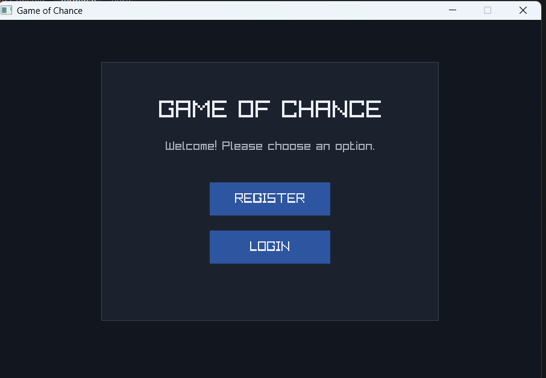

# Game of Chance

A learning and portfolio project that evolved from a Linux/POSIX command-line game written in C into a C++17 desktop application with a graphical user interface built using Raylib.

## Project Overview

**Game of Chance** is a multi-version game application developed as part of my programming learning journey.

The project began with a **C-based command-line implementation**. The C version was created to gain practical experience with procedural programming, modular program design, Linux/POSIX system programming, low-level file handling, function pointers, input validation, and basic security hardening.

After completing the C version, I continued the project by developing a **C++ version as a redesign rather than a line-by-line translation** of the original implementation.

The C++ version uses **C++17**, object-oriented programming, a separated game backend, file-based persistence, and a graphical user interface developed with **Raylib**.

The two versions share the same overall game concept, but they were developed with different programming approaches and design goals.

## Project Journey

The project follows a progression from procedural C programming to object-oriented C++ application development:

```text
C Version
    │
    │  CLI application
    │  Modular C
    │  Linux/POSIX
    │  Low-level file handling
    │  Function pointers
    │  Input validation
    │
    ▼
C++ Redesign
    │
    │  C++17
    │  Object-oriented design
    │  Encapsulation
    │  Composition
    │  Game engine
    │  File persistence
    │
    ▼
Raylib GUI
    │
    │  Desktop application
    │  GUI/backend separation
    │  Interactive gameplay
    │
    ▼
Portfolio Project
```

The purpose of this progression was not only to create a game, but to use one continuous project to learn how the same application can be designed using different programming paradigms.

## Project Objectives

The project has three main objectives:

### 1. C++ Desktop Application

Develop a functional desktop version of Game of Chance using modern C++17 concepts and a graphical interface.

### 2. Learning Progression

Use the original C implementation as a foundation for learning and transitioning from procedural C programming to object-oriented C++ design.

### 3. Portfolio Development

Build a practical project that demonstrates programming concepts including:

- C and C++ programming
- Object-oriented design
- Encapsulation and composition
- Modular application architecture
- GUI development with Raylib
- Backend and GUI integration
- File-based persistence
- Input validation
- Error handling
- Functional and edge-case testing

## Project Versions

This repository contains two implementations of Game of Chance.

### C Version

The original **Linux/POSIX command-line implementation** written in C.

It focuses on:

- Procedural programming
- Modular C design
- Linux/POSIX programming
- Low-level file operations
- Runtime function pointers
- Input validation
- Basic security review and hardening
- Persistent player data

Detailed documentation:

**[C Version README](C-version/README.md)**

### C++ Version

The redesigned **desktop GUI implementation** written in C++17.

It focuses on:

- Object-oriented programming
- Encapsulation
- Composition
- C++17 standard library features
- Separation of GUI and backend logic
- Game engine design
- Raylib GUI development
- Player sessions and state management
- File-based persistence
- Testing and validation

Detailed documentation:

**[C++ Version README](Cpp-version/README.md)**


## Features

### Common Game Features

Both versions of Game of Chance provide the core game experience around a player account, credits, wagers, and multiple games.

The C++ version additionally provides a graphical desktop interface.

The current application includes:

- Player registration and login
- Persistent player information
- Player credits and wager handling
- High-score tracking
- Three playable games
- Input validation
- Game-specific result handling
- Profile information
- Session management
- Persistent player data between application runs

### Games

#### Pick A Number

The player selects a number and attempts to match a randomly generated number.

#### Dealer No Match

The dealer generates a collection of random numbers. The player wins when the generated collection contains no duplicate values.

#### Find The Ace

The player selects one of three cards. After a queen is revealed, the player can change the selection or increase the wager before resolving the game.

### C++ GUI Features

The C++ version adds a Raylib-based graphical interface including:

- Welcome screen
- Player registration and login screens
- Main menu
- Game selection
- Interactive gameplay screens
- Find The Ace card interface
- Player profile screen
- Button hover and interaction states
- Input fields
- Credit and wager display

## Technology Stack

### C Version

| Technology | Purpose |
|---|---|
| C | Core application development |
| GCC | Compilation |
| Linux/POSIX | Runtime environment and system-level functionality |
| POSIX file operations | Player data persistence |
| Make | Build automation |

### C++ Version

| Technology | Purpose |
|---|---|
| C++17 | Application and game logic |
| GCC | Compilation |
| Raylib | Graphical user interface |
| MSYS2 UCRT64 | Windows development environment |
| Standard Library | Strings, vectors, random number generation, smart pointers, file streams |
| Text file storage | Player persistence |

## Repository Structure

The repository contains both implementations of **Game of Chance**.

The C version and C++ version are kept separately so that the progression from the original procedural implementation to the redesigned object-oriented application can be viewed within the same project.

```text
Game-of-Chance/
│
├── README.md
├── image.png
│
├── .vscode/
│   └── settings.json
│
├── C-version/
│   ├── README.md
│   │
│   ├── data/
│   │
│   ├── include/
│   │   ├── Custom_function.h
│   │   ├── game.h
│   │   ├── input.h
│   │   ├── player.h
│   │   ├── storage.h
│   │   └── ui.h
│   │
│   └── src/
│       ├── Custom_function.c
│       ├── game.c
│       ├── input.c
│       ├── main.c
│       ├── player.c
│       ├── storage.c
│       └── ui.c
│
└── Cpp-version/
    ├── README.md
    ├── game.exe
    ├── gui.exe
    │
    ├── data/
    │   └── players.txt
    │
    ├── Gui/
    │   ├── GuiApplication.cpp
    │   ├── GuiApplication.h
    │   ├── GuiStyle.cpp
    │   ├── GuiStyle.h
    │   └── main.cpp
    │
    ├── include/
    │   ├── Application.h
    │   ├── DealerNoMatch.h
    │   ├── FindTheAce.h
    │   ├── GameEngine.h
    │   ├── GameResult.h
    │   ├── PickANumber.h
    │   ├── Player.h
    │   ├── PlayerSession.h
    │   └── Storage.h
    │
    └── src/
        ├── Application.cpp
        ├── DealerNoMatch.cpp
        ├── FindTheAce.cpp
        ├── GameEngine.cpp
        ├── main.cpp
        ├── PickANumber.cpp
        ├── Player.cpp
        ├── PlayerSession.cpp
        └── Storage.cpp
```

### Directory Overview

| Directory / File | Purpose |
|---|---|
| `README.md` | Main documentation for the complete project |
| `image.png` | Project image used in the main README |
| `.vscode/` | VS Code project settings |
| `C-version/` | Original C implementation |
| `C-version/README.md` | Detailed documentation for the C implementation |
| `C-version/include/` | C header files |
| `C-version/src/` | C source files |
| `C-version/data/` | Persistent data used by the C application |
| `Cpp-version/` | C++17 implementation |
| `Cpp-version/README.md` | Detailed documentation for the C++ implementation |
| `Cpp-version/include/` | C++ class and interface headers |
| `Cpp-version/src/` | C++ backend implementations and console application |
| `Cpp-version/Gui/` | Raylib GUI implementation |
| `Cpp-version/data/` | Persistent player data for the C++ application |
| `Cpp-version/game.exe` | Console executable generated for the C++ version |
| `Cpp-version/gui.exe` | Raylib GUI executable generated for the C++ version |

### C++ Directory Organization

The C++ implementation separates the application into three main areas:

```text
Cpp-version/
│
├── include/     → Interfaces and class declarations
├── src/         → Backend and console implementation
└── Gui/         → Raylib graphical interface
```

This separation allows the game and player-management logic to exist independently from the graphical presentation layer.

## Application Preview

The following image provides a preview of the C++ desktop application's welcome, login, and registration interfaces.




## How to Use the C++ Application

The application follows a straightforward navigation flow:

1. **Welcome Screen** — Launch the application and choose whether to register a new player or log in.
2. **Registration / Login** — Create a player account or access an existing account using the player UID.
3. **Main Menu** — Access the available application options, including gameplay and player profile.
4. **Game Selection** — Choose one of the three available games.
5. **Gameplay** — Enter wagers and interact with the selected game.
6. **Player Profile** — View player information, available credits, and high score.
7. **Logout** — End the current player session.

Player information is stored locally and can be loaded again when the application is restarted.

## Build & Run

Both implementations have their own build instructions and development requirements.

### C Version

The C version is designed for a Linux/POSIX environment and can be compiled using GCC.

For detailed build instructions, dependencies, and execution steps, refer to:

**[C Version — Build & Run](C-version/README.md#build-and-run)**

### C++ Version

The C++ version uses C++17 and has two application interfaces:

- Console-based application
- Raylib-based graphical desktop application

The graphical version requires Raylib and a compatible development environment.

For detailed dependencies, compiler commands, and execution instructions, refer to:

**[C++ Version — Build & Run](Cpp-version/README.md#build-and-run)**

## AI Assistance & Acknowledgement

AI tools, including **ChatGPT and Claude**, were used as development assistants throughout this project.

Their assistance was particularly significant during the development of the C++ graphical user interface, including UI design, implementation, and integration with the existing backend. AI assistance was also used for selected backend components, debugging, architectural discussions, and code review.

The development process involved using these tools alongside personal implementation, experimentation, testing, and iterative improvements.

This project represents my practical learning experience with C programming, C++ development, object-oriented design, and graphical application development, with AI serving as one of the tools used during that process.

## Project Status

Both the C and C++ implementations have reached their current completed learning-project milestones.

- **C Version:** Completed Linux/POSIX command-line implementation.
- **C++ Version:** Completed C++17 desktop application with a Raylib graphical interface.

The project is considered complete for its current scope. Further learning, code understanding, auditing, and improvements may continue as part of future development.
